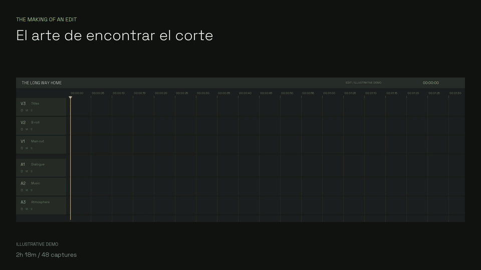

# TimelineLapse

**Mostrá cómo nació tu edición.**

Una herramienta local para convertir el proceso de edición en un timelapse de tu timeline real. Compartís la ventana de DaVinci, recortás la zona de pistas y guardás una captura cada pocos segundos. Al terminar, exportás un MP4.

*La demo es simulada. Tus sesiones usan capturas reales de la ventana que elijas.*

## Abrir

Necesitás Python 3.10 o posterior, Chrome o Edge de escritorio y FFmpeg para exportar MP4. No requiere paquetes de Python ni cuenta.

1. Descomprimí la carpeta del proyecto.
2. Si falta Python, instalalo desde [python.org](https://www.python.org/downloads/).
3. Instalá FFmpeg: en Mac con Homebrew, `brew install ffmpeg`; en Windows, `winget install Gyan.FFmpeg`.
4. En una terminal dentro de la carpeta, ejecutá `python3 app.py` (Windows: `python app.py`). En Mac también podés abrir `Open TimelineLapse.command`.
5. Abrí [http://127.0.0.1:8765](http://127.0.0.1:8765).

## Grabar

1. Abrí DaVinci en la página Edit y acomodá tu timeline.
2. Presioná **Elegir ventana**. En el selector del navegador, elegí DaVinci.
3. Dibujá el recorte alrededor de las pistas y confirmalo.
4. Elegí el intervalo y presioná **Grabar mi edición**.
5. Volvé a DaVinci y editá. Dejá el navegador abierto, el equipo despierto y la timeline visible en la ventana compartida.
6. Volvé a TimelineLapse, presioná **Finalizar**, revisá la reproducción y exportá.

En macOS puede hacer falta permitir la grabación de pantalla al navegador en Ajustes del Sistema. La selección de ventana la hacés vos, cada vez que compartís.

La captura no depende de la API de DaVinci: funciona sobre la ventana visible de Free o Studio y también puede usarse con otros editores. La disponibilidad de compartir ventanas depende del navegador y el sistema.

## Qué queda guardado

Solo las capturas del recorte seleccionado. Se conservan localmente en `.timelinelapse/`, una carpeta excluida de Git. **Guardar capturas** descarga un ZIP de la sesión. El servidor escucha únicamente en tu computadora y no envía el material a servicios externos.

Los formatos de presentación agregan un título y un fondo. **Solo timeline** conserva el recorte completo. El MP4 no tiene audio ni marca de agua. Cada captura conservada recibe el mismo tiempo de pantalla; al final se agrega una pausa de un segundo.

## Límites de esta primera versión

- Empezá a grabar antes de editar. No recupera el historial anterior de un proyecto.
- Registra el área visible: no conoce los clips ni lee el historial de acciones de DaVinci.
- El filtro compara imágenes. Un movimiento del cabezal o un zoom pueden generar capturas; cambios pequeños pueden omitirse. Desactivalo si querés guardar todos los intervalos.
- Si minimizás la ventana, cerrás el navegador o el sistema lo suspende, la captura puede detenerse. Revisá el contador durante una sesión larga.
- Cambiar el tamaño de la ventana o mover paneles puede alterar el recorte. Finalizá y creá otra sesión si necesitás reencuadrar.
- Las imágenes guardadas sobreviven a un cierre inesperado. La conexión con la pantalla y el temporizador no se reanudan automáticamente.
- Las sesiones no se borran solas. Exportá un ZIP antes de quitar una carpeta de sesión para recuperar espacio.
- La demo, la captura sintética y la exportación se verifican por separado. La primera sesión real requiere que elijas la ventana y pruebes el recorte en tu equipo.

Código abierto bajo MIT. [Documentación técnica en inglés](README.md).
