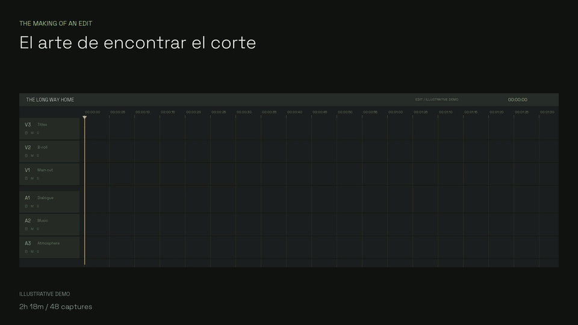

# TimelineLapse

**Your timeline has a story. Show how it was built.**

Turn hours of editing into a short timelapse of your **real timeline**. Choose your editor's window, crop to the tracks, and let TimelineLapse save screenshots while you work. Replay the session and export an MP4.



*The demo above is simulated. Your recordings use actual screenshots from the window you choose.*

[Español](README.es.md) · [Demo MP4](assets/demo.mp4) · [How it works](#how-it-works)

## Run locally

Requires **Python 3.10+**, desktop **Chrome or Edge**, and **FFmpeg with libx264 and drawtext** for MP4 export. No Python packages, account, API key, or subscription.

1. Download this project and unzip it.
2. Install Python from [python.org](https://www.python.org/downloads/) if needed.
3. Install FFmpeg:

   ```sh
   # macOS with Homebrew
   brew install ffmpeg
   # Windows
   winget install Gyan.FFmpeg
   # Ubuntu / Debian
   sudo apt install ffmpeg
   ```

4. Open a terminal in the project folder:

   ```sh
   python3 app.py
   # Windows: python app.py
   ```

Your browser opens at **http://127.0.0.1:8765**. You can also use `Open TimelineLapse.command` on macOS or `Open TimelineLapse.bat` on Windows after installing Python. If the port is occupied, run `python3 app.py --port 8766`.

The interface is currently in Spanish. The buttons to start are **Elegir ventana** (choose window), **Usar este recorte** (use crop), and **Grabar mi edición** (record).

## Record your edit

1. Open your editing timeline and arrange the tracks you want to show.
2. Choose **Elegir ventana** and share your DaVinci Resolve window. Pick a window, not an entire display, when possible.
3. Drag a rectangle around the timeline. Only that crop is saved.
4. Pick a capture interval (1–30 seconds) and start recording.
5. Return to your editor. Keep the shared timeline visible, the browser open, and the computer awake.
6. Finish the session, replay it, choose a duration and format, and export your MP4.

On macOS, your browser may need Screen Recording permission in System Settings. The browser always asks you to choose the shared surface; the app cannot silently select it.

## Features

- Actual timeline screenshots, without a Resolve plug-in or project API.
- Custom crop: avoid including viewers, bins, and unrelated parts of the window.
- Capture intervals, pause/resume, and an optional filter for nearly identical screenshots.
- Frames written to disk as they arrive; sessions remain available after restarting the server.
- Session playback, scrubbing, and full-screen preview.
- H.264 MP4: landscape presentation, portrait presentation, or just the native timeline crop.
- 6, 12, 20, or 30-second timelapses, with a one-second final hold.
- Download original session captures as a ZIP.
- No watermark, audio recording, analytics, or remote processing.

The capture method works independently of Free/Studio licensing: it records a chosen window instead of connecting to Resolve's scripting API. Other desktop editors can be captured in the same way. Window sharing behavior depends on your OS and browser.

## How it works

```text
User-selected editor window
    → Browser screen-sharing stream
    → User-defined crop
    → Interval JPEGs saved to a local Python server
    → Preview + FFmpeg MP4 export
```

The browser reads the shared window into a canvas at each interval. A small grayscale fingerprint can skip nearly identical frames. This is visual comparison: playhead movement, scrolling, or zooming may count as a change; very small edits may be skipped. Turn the filter off when every interval matters.

The server binds only to `127.0.0.1`. Captures are sent only to this local server and saved under `.timelinelapse/`, which is ignored by Git. The server does not upload sessions to GitHub or anywhere else. Only the cropped screenshots are written; source media and project files are not read.

Export assigns equal screen time to each retained capture, then holds the last image for one second. It does not preserve the timing of pauses. The native format keeps the full crop at up to 1920×1080 without presentation text. Portrait/landscape formats add a matte and title. Exports are silent.

## Scope of this alpha

- **Start recording before editing.** Existing project files do not contain this app's capture history. It cannot recreate past sessions.
- This records the **visible timeline**, not hidden tracks or an entire project's semantic edit history. It does not identify individual clip operations, capture every action, or read undo history.
- Keep your framing consistent. Resizing/rearranging the editor can change what a proportional crop includes. Stop and create a new session to reframe it.
- Browsers and operating systems may pause or freeze a minimized/shared window or suspend background pages. A muted capture track pauses recording; other freezes may be skipped as similar frames. Check the session counter during a long edit.
- The capture filter reduces repetition; it is not a detector for edits. The default comparison threshold is conservative but may omit tiny visual changes.
- Captures survive a browser crash, but the screen-sharing stream and current pause timer do not. Reopen a saved session to view/export it, then start a new recording for further edits.
- No session auto-deletion. Download your frames as a ZIP before moving/removing old folders from `.timelinelapse/` to reclaim disk space.
- The simulated demo and export path are tested. A first live DaVinci recording still needs the user to grant window sharing and verify their crop on their OS.

## Development

Python standard library backend, vanilla HTML/CSS/JS frontend, local Space Grotesk font, FFmpeg export. No build step.

```sh
python3 app.py --no-browser
python3 -m unittest discover -s tests -v
```

`tests/browser_fixture.py` serves the actual app with a synthetic window-sharing source for exercising the crop, interval capture, pause/resume, persistence, and export flow without OS permissions. This is a test fixture, not a live Resolve integration test:

```sh
python3 tests/browser_fixture.py
# Open http://127.0.0.1:8766
```

To regenerate the illustrative demo only: install Pillow in a development environment and run `python3 docs/generate_demo.py`. Pillow is not needed to use TimelineLapse.

## Credits and license

Created for [brainbtz7-cell](https://github.com/brainbtz7-cell). Code and illustrative demo: MIT. Space Grotesk: SIL Open Font License, bundled in `assets/FONT-LICENSE.txt`. FFmpeg is a separately installed tool under its own license. DaVinci Resolve is a Blackmagic Design product; this project is independent.
